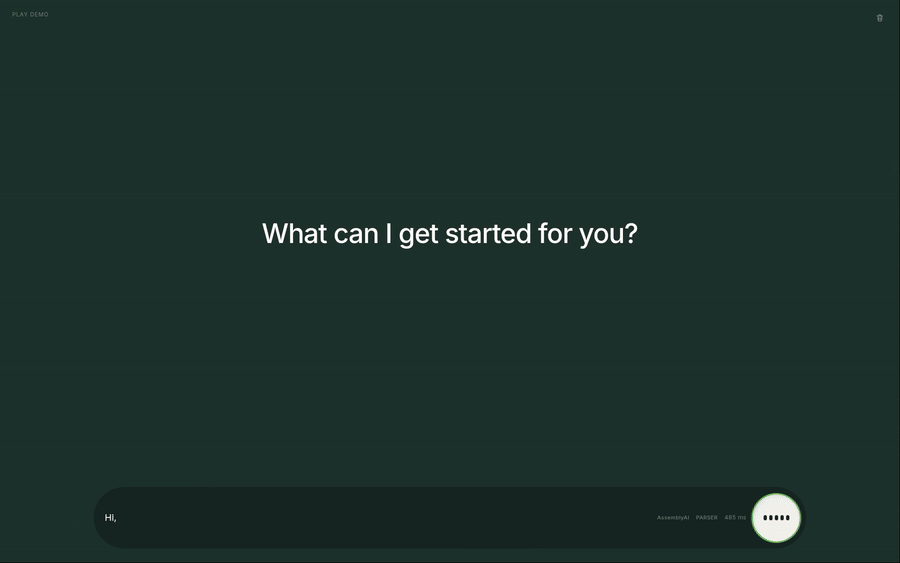
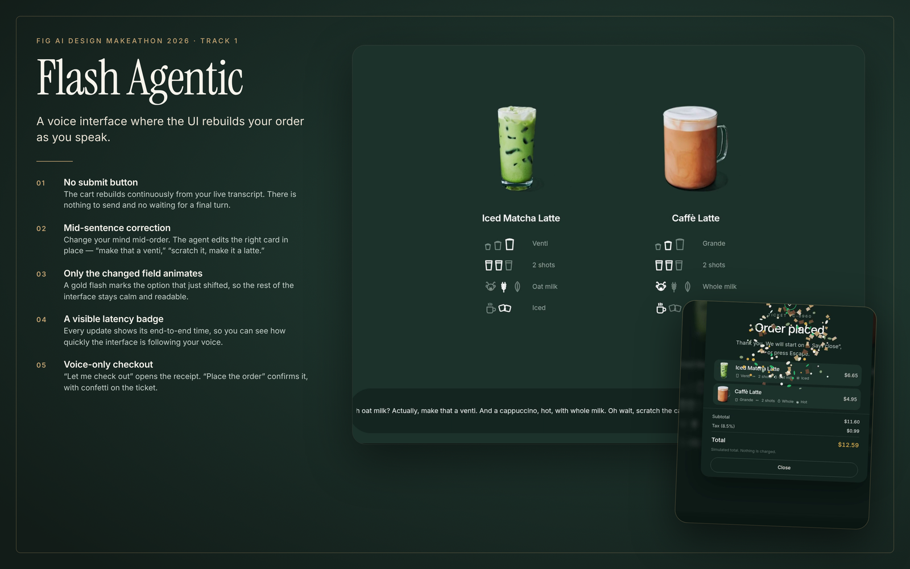
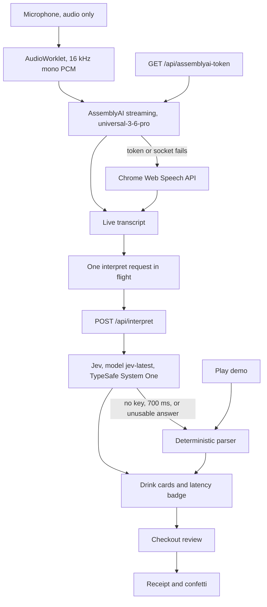

<!-- DEMO_VIDEO_ATTACHMENT -->

https://github.com/bvsbharat/FlashAgentic/raw/main/demo/flash-agentic-demo.mp4

<video src="https://github.com/bvsbharat/FlashAgentic/raw/main/demo/flash-agentic-demo.mp4" controls width="100%"></video>

<p align="center">
  <a href="https://github.com/bvsbharat/FlashAgentic/blob/main/demo/flash-agentic-demo.mp4">
    
  </a>
</p>

<p align="center">
  <a href="https://github.com/bvsbharat/FlashAgentic/blob/main/demo/flash-agentic-demo.mp4"><strong>Watch the full demo (50s, with audio)</strong></a>
</p>

<p align="center">
  
</p>

<h1 align="center">Flash Agentic</h1>

<p align="center">voice-first coffee ordering: just say what you want, and the cart builds itself in real time</p>

<p align="center">
  <a href="https://voice-coffee.vercel.app"></a>
  <a href="https://stellar-foxtrot-e63.notion.site/Flash-Agentic-416f1da6863a81e581d0dd4a5069e1e7"></a>
  <a href="https://nextjs.org"></a>
  <a href="https://www.typescriptlang.org"></a>
  <a href="https://vercel.com"></a>
</p>

<p align="center">
  <a href="https://voice-coffee.vercel.app"><strong>Live demo</strong></a>
  &nbsp;·&nbsp;
  <a href="https://stellar-foxtrot-e63.notion.site/Flash-Agentic-416f1da6863a81e581d0dd4a5069e1e7"><strong>Project page</strong></a>
</p>

## What it is

A full-screen coffee counter with no drink menu. You say the order, and the cart is the interface: cards appear, change, and leave while the sentence is still going. Size, shots, milk, and temperature update on the drink you meant, including “that one”, “one of the lattes”, and “the other one”.

The microphone is audio only. Nothing asks for a camera.

## Features

| | |
| --- | --- |
| Live speech to text | AssemblyAI streaming (`universal-3-6-pro`). If the token or the socket fails, Chrome’s Web Speech API takes over. The pill labels the engine **AssemblyAI** or **Chrome**. |
| Real-time cart | Every interim transcript is posted to `/api/interpret`. One request is in flight; the newest sentence waits and goes out as soon as the current one returns. |
| Mid-sentence corrections | “make that a venti” retargets the drink in focus. “scratch the cappuccino” removes it. The same parser understands “the small one”, “one of the lattes”, and “the other one”. A changed field flashes gold for 1.35s. |
| Voice checkout and confirm | “let me check out” opens the ticket. “place the order”, “place it”, or “confirm” places it. “go back” or “never mind” returns to the counter. |
| Receipt with confetti | The ticket lists each drink, a subtotal, 8.5% tax, and a total. The total is simulated and nothing is charged. Placing the order shows a four-digit ticket number and confetti. Reduced motion skips the burst. |
| Latency badge | The transcript pill prints the decision time in milliseconds. Live mode times the `/api/interpret` round trip. Demo playback uses the scripted per-word times. |

## Poster

<p align="center">
  
</p>

## Demo walkthrough

Press **Play demo** (or `D`) and the page replays this script locally. Demo playback does not call the network. It runs the deterministic parser, so the cart matches the lines below with or without API keys.

A new drink starts as grande, 2 shots, whole milk, and hot. “Matcha” is a matcha latte. “Latte” is a caffè latte. Small is tall. Large is venti.

| Time | Spoken line | Cart |
| --- | --- | --- |
| 1.65s | “can i get a matcha” | Hot matcha latte, grande, 2 shots, whole milk |
| 3.55s | “let's make it iced” | That matcha turns iced |
| 5.35s | “with oat milk” | Oat milk on the matcha |
| 6.70s | “and can we add one cappuccino” | Hot cappuccino, grande, 2 shots, whole |
| 10.05s | “and one latte” | Hot caffè latte beside it |
| 12.20s | “actually can we add one more latte” | A second hot latte |
| 14.55s | “for one of the lattes can we make it large” | The latest latte becomes venti |
| 16.55s | “and then the other one small” | The earlier latte becomes tall |
| 18.70s | “and then for the small one can we do three shots” | The tall latte goes to 3 shots |
| 21.90s | “with oat milk” | Oat milk on the tall latte |
| 26.10s | “and let's make that one iced actually” | The tall latte turns iced. The venti latte stays hot |
| 29.80s | “awesome actually let's get rid of the cappuccino” | Cappuccino leaves. Three drinks remain, in order |
| 35.40s | “let me check out” | Review opens: “Say place the order to confirm.” |
| 40.80s | “place the order” | Ticket number, receipt, and confetti |

The ticket at the end is:

- Iced matcha latte, grande, 2 shots, oat
- Iced caffè latte, tall, 3 shots, oat
- Caffè latte, venti, 2 shots, whole, hot

## Architecture

The browser captures the microphone, downsamples it to 16 kHz mono 16-bit PCM in an AudioWorklet, and streams that PCM to AssemblyAI. The API key stays on the server. `GET /api/assemblyai-token` mints a short-lived streaming token (`expires_in_seconds` 60) and the page opens `wss://streaming.assemblyai.com/v3/ws` with model `universal-3-6-pro` in `min_latency` mode. Partial turns replace the open phrase. If the socket drops or the session nears its cap, the page seals the words it already has, mints a new token, and reconnects. A missing key, a failed token, or a socket error falls back to Chrome (`webkitSpeechRecognition`, continuous, interim results, on-device when a language pack is installed).

Live text goes to `POST /api/interpret`. When `JEV_API_KEY` is set, the server calls `TypeSafeClient.systemOne` from `@typesafe-ai/sdk` at `POST https://api.typesafe.ai/v1/systemone`, model `jev-latest`. One request asks twenty Choice questions: four drink slots, each with type, size, shots, milk, and temperature. Retries are off. A call that passes 700ms, fails, or returns nothing usable falls back to the parser in `lib/parser.ts`. The browser only learns which path answered (`source` is `"jev"` or `"parser"`). The key never leaves the server.

There is no text-to-speech service. The reply is the cart: drink cards, a gold flash on the field that changed, the latency badge, and the receipt. A polite `aria-live` region repeats the same order for assistive tech.



In this repository, `next.config.ts` rewrites `/api/*` to the live deployment, which holds the server keys. Demo playback never takes that path.

## Tech stack

- [Next.js](https://nextjs.org) 15.5 (App Router) and React 19
- TypeScript 5
- Tailwind CSS 4 and Framer Motion for the cards, the start screen, and the checkout transition
- [AssemblyAI](https://www.assemblyai.com) streaming speech-to-text, model `universal-3-6-pro`, with Chrome Web Speech as the fallback
- [Jev](https://docs.typesafe.ai) through [`@typesafe-ai/sdk`](https://docs.typesafe.ai/sdk/javascript), model `jev-latest`
- A deterministic parser for demo playback and for any live turn Jev does not answer
- [Vercel](https://vercel.com) for the public demo

## Getting started

```bash
git clone https://github.com/bvsbharat/FlashAgentic.git
cd FlashAgentic
npm install
cp .env.example .env.local
npm run dev
npm run build
```

`npm run dev` starts Next.js with Turbopack. `npm run build` is `next build --turbopack`. `npm test` runs the parser, checkout, Jev, speech, and microphone tests. The tests do not call TypeSafe or AssemblyAI.

`.env.example` lists two server-only names. Leave them empty, or set them in `.env.local`. Do not prefix either name with `NEXT_PUBLIC_`, and do not commit `.env.local`.

| Name | Role |
| --- | --- |
| `JEV_API_KEY` | Server key for Jev. Empty, or a failed call, uses the parser. |
| `ASSEMBLYAI_API_KEY` | Server key for AssemblyAI streaming. Empty, or a failed socket, uses Chrome. |

## Project structure

```
app/                  page, layout, global CSS
components/           counter, drink cards, transcript pill, start screen, checkout, confetti
lib/parser.ts         spoken order to drinks
lib/checkout.ts       review, confirm, receipt, ticket number
lib/checkout-cues.ts  phrases that open, confirm, or cancel checkout
lib/jev.ts            Jev client, 700 ms, no retries
lib/interpret.ts      Jev first, parser when Jev cannot answer
lib/assemblyai-token.ts
lib/assemblyai-transcript.ts
lib/demo.ts           timed demo script
lib/pcm.ts            16 kHz PCM capture
public/drinks/        hot and iced art for matcha, cappuccino, and latte
public/pcm-worklet.js
demo/flash-agentic-demo.mp4
docs/demo.gif
docs/logo.jpg
docs/poster.png
scripts/shoot.mjs     local frame capture against the dev server
```

## Deploy

The public app is [https://voice-coffee.vercel.app](https://voice-coffee.vercel.app).

This repo builds with `npm run build`. `next.config.ts` forwards every `/api/*` request to that deployment, so a local dev server uses the live interpret and token routes. The browser still receives only a short-lived AssemblyAI token and a drink list. It does not receive either API key.

## Roadmap

- More than the three drinks the parser names today, and more than the four slots Jev fills.
- A real charge after the receipt. The total on screen is a simulated quote.
- A spoken reply. The counter answers on screen today, and the `aria-live` region is the only spoken-adjacent path.
- Remember the order after a refresh. Clearing the cart, or closing a placed ticket, drops it.

## License

This repository does not include a license file.
